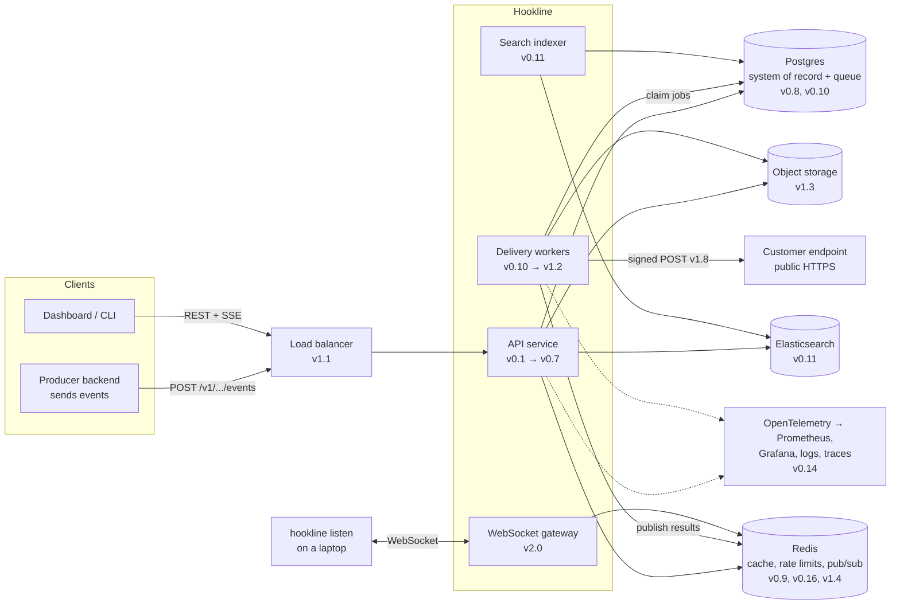

# Architecture

This is where Hookline is heading by `v2.0`. Early versions are much simpler; each part below appears in the version noted next to it.

## The v2.0 picture



## Life of one event (v1.0)

1. A producer calls `POST /v1/apps/{app_id}/events` with an API key and an `Idempotency-Key`.
2. Middleware assigns a request ID, logs, authenticates the key (cached), applies the org's rate limit.
3. The handler decodes and validates the body; the service checks business rules.
4. In **one transaction**: insert the message, insert one delivery job per subscribed endpoint, insert an outbox row for the search indexer.
5. Respond `202 Accepted` with the message ID.
6. A worker claims a job with `FOR UPDATE SKIP LOCKED` and a lease.
7. The worker signs the payload and POSTs it through an SSRF-safe HTTP client with a timeout.
8. It records an attempt. On success the job is done; on a retryable failure it's rescheduled with backoff and jitter; after the last try it's marked failed.
9. Metrics, logs and one trace cover the whole path from step 1 to step 8.

## Tech stack

| Concern | Choice | Why |
|---|---|---|
| Language | Go | Small standard library close to first principles (`net/http`, `context`, goroutines, signals). Single binary. Widely used for infrastructure. |
| HTTP routing | `net/http` `ServeMux` | Learn routing without a framework. Revisit only with an ADR. |
| Database | PostgreSQL + `pgx` + `sqlc` | SQL you write yourself, type-safe Go generated from it. |
| Migrations | `goose` | Versioned SQL files. |
| Queue | Hand-built on Postgres (`SKIP LOCKED`) | Understand queues before using one. Revisit (River, NATS, Kafka) in an ADR. |
| Cache, rate limits, pub/sub | Redis (or Valkey) | One well-understood tool for three jobs. |
| Search | Elasticsearch (or OpenSearch) | As taught in video 15; Postgres FTS first for comparison. |
| Object storage | MinIO locally, S3-compatible in prod | Same API everywhere. |
| Observability | `log/slog`, OpenTelemetry, Prometheus, Grafana | Vendor-neutral standards. |
| Testing | `testing`, `httptest`, testcontainers-go, k6 | Real dependencies in integration tests. |
| Contract | OpenAPI 3.1 | Video 28. |
| Delivery | Docker, docker-compose, GitHub Actions | Twelve-factor, reproducible. |

The concepts transfer to any stack. If a later ADR moves part of Hookline to another language, the roadmap still holds.

## Repository layout (target)

```
cmd/
  api/        HTTP API server
  worker/     delivery workers
  indexer/    search indexer
  sink/       test receiver for local development
  hookline/   CLI (listen, send)
internal/
  http/       handlers, middleware, routing
  app/        services (business logic, no HTTP types)
  store/      repository interfaces + Postgres implementations
  queue/      job claiming, leases, scheduling
  delivery/   HTTP client, signing, retry policy, SSRF guard
  config/
  observability/
migrations/
api/openapi.yaml
deploy/       docker-compose, dashboards, load tests
docs/         adr, learning-log, diagrams, perf, security
```
